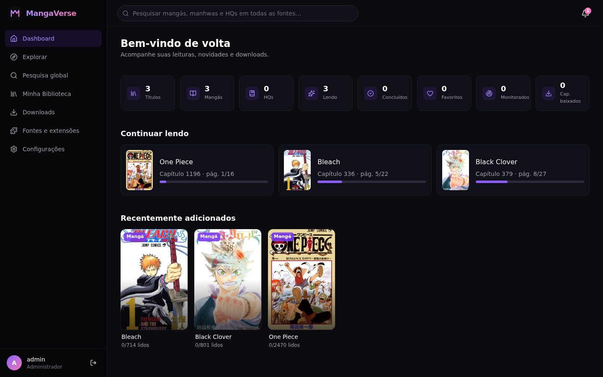
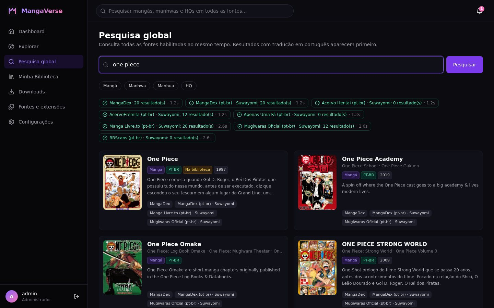
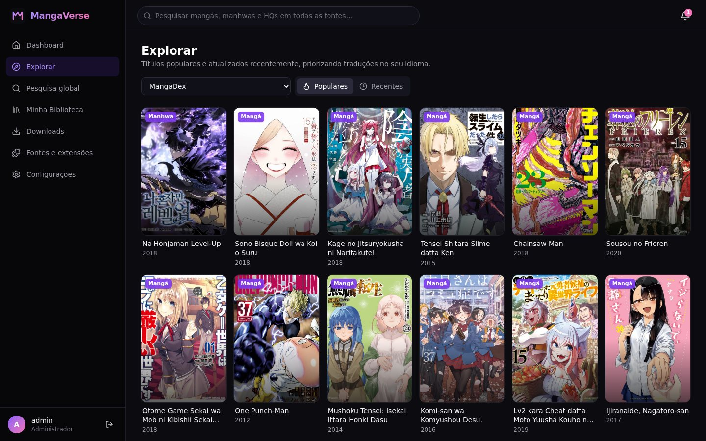
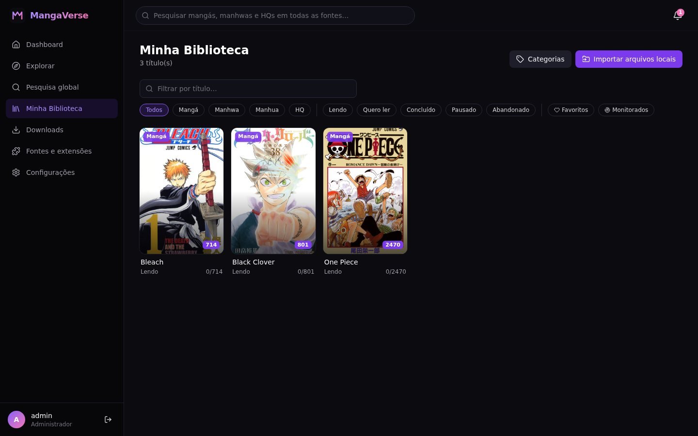
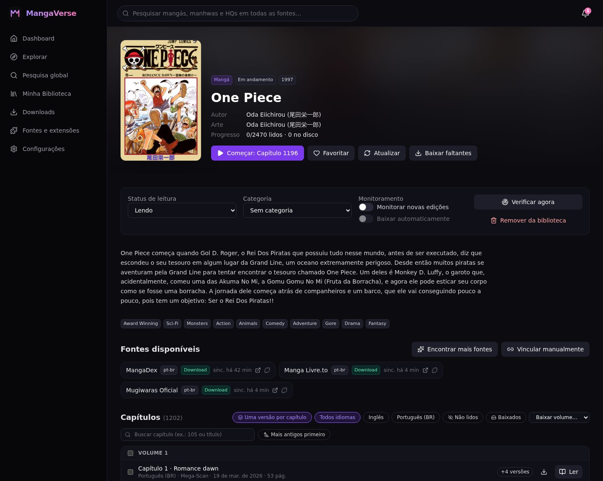
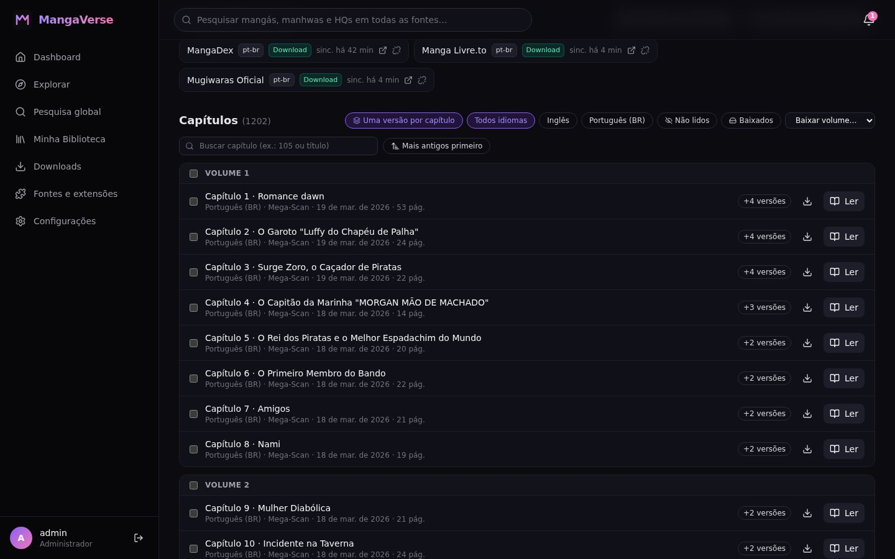
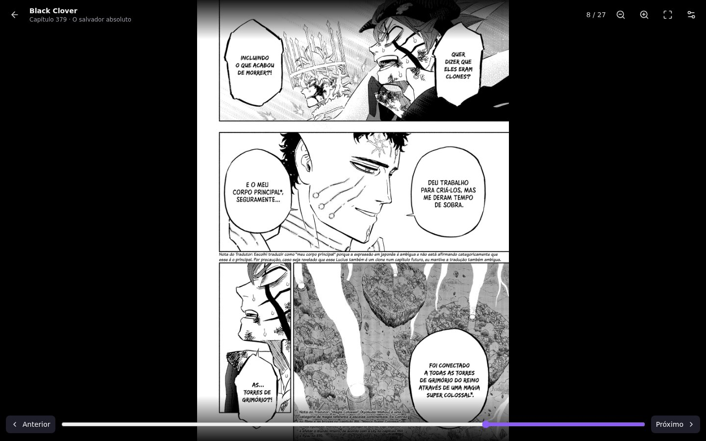
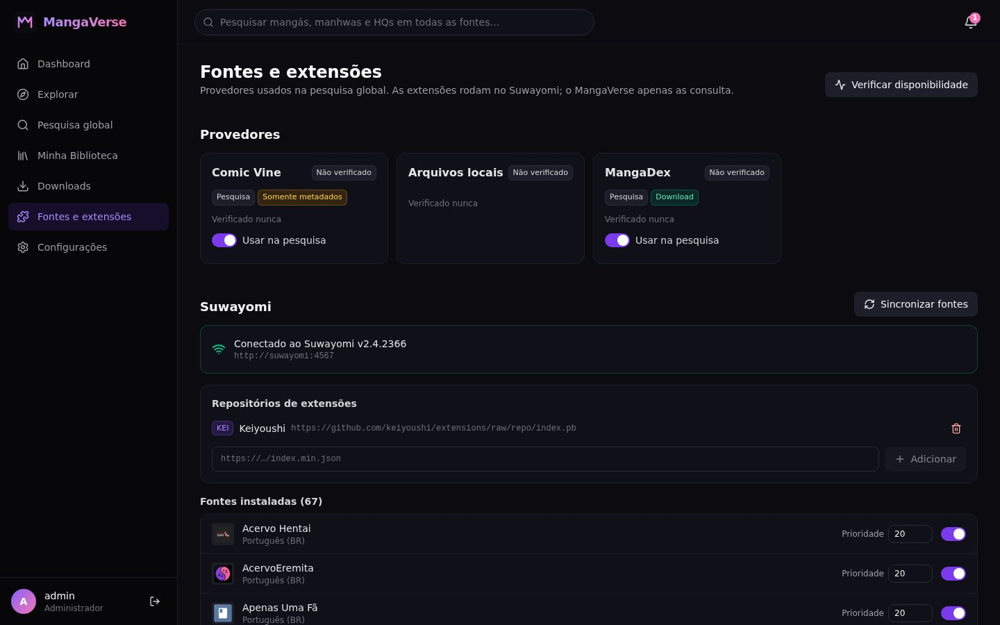
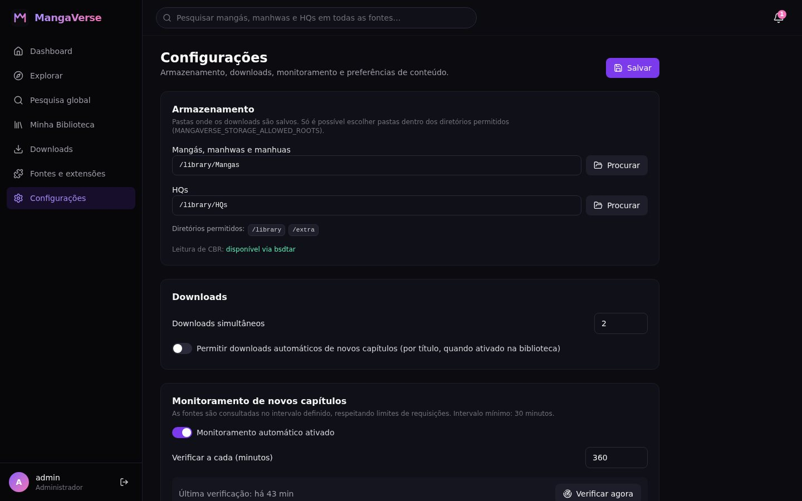

# MangaVerse

Gerenciador self-hosted de **mangás, manhwas, manhuas e HQs**, no estilo do Sonarr: pesquisa em várias
fontes ao mesmo tempo, biblioteca pessoal, downloads em CBZ, leitor no navegador e monitoramento
automático de novos capítulos.

- **Backend:** Java 21, Spring Boot 4.1 (Web MVC, Data JPA, Security, Validation, Cache, Scheduling), WebClient, Flyway, PostgreSQL
- **Frontend:** React 19 + TypeScript, Vite, Tailwind CSS 4, React Router, TanStack Query, Axios, Lucide
- **Infra:** Docker Compose com PostgreSQL, backend, frontend (nginx) e Suwayomi Server



## Telas

| Pesquisa global | Explorar |
|---|---|
|  |  |
| **Minha Biblioteca** | **Detalhes do título** |
|  |  |
| **Capítulos com busca, ordem e uma versão por capítulo** | **Leitor** |
|  |  |
| **Fontes e extensões (Suwayomi/Keiyoushi)** | **Configurações** |
|  |  |

<p align="center"></p>

---

## Sumário

1. [Status do projeto](#status-do-projeto)
2. [Arquitetura](#arquitetura)
3. [Instalação com Docker (recomendado)](#instalação-com-docker-recomendado)
4. [Instalação no Arch Linux (sem Docker)](#instalação-no-arch-linux-sem-docker)
5. [Instalação no Windows](#instalação-no-windows)
6. [Configuração](#configuração)
7. [Primeiros passos](#primeiros-passos)
8. [Integrações e limites das fontes](#integrações-e-limites-das-fontes)
9. [Armazenamento e formatos](#armazenamento-e-formatos)
10. [Segurança](#segurança)
11. [Testes](#testes)
12. [API REST](#api-rest)
13. [Limitações conhecidas e próximos passos](#limitações-conhecidas-e-próximos-passos)

---

## Status do projeto

Todas as fases planejadas foram implementadas e verificadas contra serviços reais
(MangaDex e Suwayomi v2.4.2366) e com a suíte automatizada (66 testes).

| Fase | Situação | O que foi entregue |
|---|---|---|
| 1 — Estrutura | ✅ Concluída | Backend Spring Boot, frontend React, PostgreSQL, Docker Compose, Flyway (`V1__initial_schema.sql`) |
| 2 — Integrações | ✅ Concluída | Cliente GraphQL do Suwayomi (schema conferido por introspecção), MangaDex, Comic Vine, gerenciamento de fontes/extensões/repositórios (Keiyoushi) |
| 3 — Pesquisa | ✅ Concluída | Pesquisa global paralela, agregação, deduplicação, prioridade pt-BR, filtros por tipo, página de detalhes |
| 4 — Biblioteca | ✅ Concluída | Adicionar/remover, status de leitura, favoritos, categorias, importação de arquivos locais |
| 5 — Downloads | ✅ Concluída | Fila persistente, concorrência configurável, pausa/retomada, cancelamento, retry, verificação de integridade, CBZ com `ComicInfo.xml` |
| 6 — Leitor | ✅ Concluída | Vertical, página única, página dupla, RTL, zoom, tela cheia, teclado, toque, progresso automático |
| 7 — Automação | ✅ Concluída | Monitoramento agendado, notificações, download automático opcional |
| 8 — Refinamento | ✅ Concluída | Interface responsiva, estados de carregamento/erro, testes, documentação |

**Verificado manualmente:** login com CSRF, pesquisa agregada (MangaDex + fonte do Suwayomi),
detalhes, adicionar à biblioteca, leitura remota e local, download para CBZ (no host via Docker),
importação local (CBZ, pasta de imagens, CBR via bsdtar), monitoramento agendado e telas no desktop e no celular.

**Não verificado ao vivo:** Comic Vine — não havia chave de API disponível. A integração segue
o formato documentado da API (confirmado com uma chamada real que retornou `Invalid API Key`) e está
coberta por testes com respostas simuladas. Veja [Limitações](#limitações-conhecidas-e-próximos-passos).

---

## Arquitetura

```
                ┌──────────────────────┐
 Navegador ───► │ frontend (nginx)     │  /api/* ─────────┐
                │ React + Vite build   │                  │
                └──────────────────────┘                  ▼
                                              ┌────────────────────────┐
                                              │ backend (Spring Boot)  │
                                              │  ContentProvider SPI   │
                                              │  ├─ MangaDexProvider ──┼──► api.mangadex.org
                                              │  ├─ ComicVineProvider ─┼──► comicvine.gamespot.com
                                              │  └─ SuwayomiSource… ───┼──► suwayomi:4567/api/graphql
                                              │  Downloads · Leitor ·  │        └─ extensões Keiyoushi
                                              │  Monitor · Biblioteca  │
                                              └───────┬───────┬────────┘
                                                      │       │
                                            PostgreSQL ◄┘       └► Biblioteca no host (CBZ/CBR/PDF)
```

### Camada de provedores

`com.mangaverse.provider.spi.ContentProvider`:

```java
List<RemoteTitle>   search(SearchQuery)
RemoteTitleDetails  getDetails(String externalId)
List<RemoteChapter> getChapters(String externalId, Set<String> languages)
Set<String>         getAvailableLanguages(String externalId)
List<RemoteChapter> checkUpdates(String externalId, Set<String> known, Set<String> languages)
List<PageRef>       getPages(String chapterId)        // somente se capabilities().read()
FetchedImage        fetchPage(PageRef)                 // somente se capabilities().read()
List<RemoteTitle>   discover(DiscoverKind, …)          // somente se capabilities().discover()
ProviderCapabilities capabilities()                    // o que o provedor realmente oferece
```

| Provedor | Pesquisa | Capítulos | Leitura | Download | Observação |
|---|---|---|---|---|---|
| MangaDex | ✅ | ✅ (filtra `pt-br`, `en`…) | ✅ (MangaDex@Home) | ✅ | Capítulos com `externalUrl` (editoras oficiais) só têm link |
| Fonte do Suwayomi (`suwayomi:<id>`) | ✅ | ✅ | ✅ | ✅ | A extensão roda no Suwayomi, nunca no backend |
| Comic Vine | ✅ (somente HQs) | ✅ edições (metadados) | ❌ | ❌ | Metadados: editora, sinopse, personagens, capa |
| Arquivos locais | — | ✅ | ✅ | — | CBZ, CBR, PDF, pastas de imagens |

### Banco de dados

Tabelas (todas com chave primária UUID): `users`, `providers`, `contents`, `content_sources`,
`chapters`, `downloads`, `reading_progress`, `library_entries`, `categories`, `app_settings`,
`update_history`. Restrições que evitam duplicidade:

- `content_sources (provider_id, external_id)` único — o mesmo título de uma fonte nunca é importado duas vezes;
- `chapters (content_source_id, external_id)` e `chapters (local_path)` únicos;
- `library_entries (user_id, content_id)` e `reading_progress (user_id, chapter_id)` únicos;
- índice parcial `downloads (chapter_id) WHERE status IN ('QUEUED','DOWNLOADING','PAUSED')` — um download ativo por capítulo.

### Estrutura do repositório

```
mangaverse/
├── backend/                 Spring Boot (Maven wrapper incluso)
│   ├── src/main/java/com/mangaverse/
│   │   ├── provider/        SPI, MangaDex, Comic Vine, Suwayomi, proxy de imagens
│   │   ├── search/          pesquisa global e agregação
│   │   ├── content/         títulos, fontes, capítulos
│   │   ├── library/         biblioteca, categorias, importação local
│   │   ├── download/        fila, motor de downloads, CBZ
│   │   ├── reader/          páginas e progresso
│   │   ├── monitor/         monitoramento e notificações
│   │   ├── storage/         PathGuard, nomes de arquivo, leitores CBZ/CBR/PDF
│   │   └── …                config, user, settings, dashboard, common
│   └── src/main/resources/db/migration/   migrations Flyway
├── frontend/                React + Vite
├── docs/suwayomi-schema.md  operações GraphQL validadas
├── docker-compose.yml
└── .env.example
```

---

## Instalação com Docker (recomendado)

Requisitos: Docker 24+ com Docker Compose v2.

```bash
cd mangaverse
cp .env.example .env
# edite .env: troque POSTGRES_PASSWORD, defina MANGAVERSE_ADMIN_PASSWORD e as pastas da biblioteca
mkdir -p data/library data/extra          # ou as pastas que você indicar no .env
docker compose up -d --build
```

Acesse **http://localhost:5180** e entre com `MANGAVERSE_ADMIN_USERNAME` / `MANGAVERSE_ADMIN_PASSWORD`.
Se a senha ficar vazia, uma senha aleatória é gerada na primeira inicialização:

```bash
docker compose logs backend | grep "Senha gerada"
```

Serviços e portas (todas publicadas apenas em `127.0.0.1` por padrão):

| Serviço | Porta | Volume persistente |
|---|---|---|
| frontend (nginx) | `5180` | — |
| backend | `8090` | `backend_data` (cache de CBR, temporários de download) |
| postgres | `5433` | `postgres_data` |
| suwayomi | `4567` | `suwayomi_data` (extensões, repositórios, cache) |

Para acessar de outros dispositivos da rede, defina `FRONTEND_BIND=0.0.0.0` no `.env`.

### Volumes da biblioteca no Linux

A biblioteca fica **no host**, fora dos containers. No `.env`:

```env
MANGAVERSE_LIBRARY_HOST_DIR=/mnt/HD2/MangaVerse   # montado como /library no container
MANGAVERSE_EXTRA_HOST_DIR=/mnt/HD3/HQs            # montado como /extra (opcional)
PUID=1000                                          # saída de `id -u`
PGID=1000                                          # saída de `id -g`
```

Crie as pastas antes de subir (`mkdir -p /mnt/HD2/MangaVerse`) para que pertençam ao seu usuário.
Na interface, em **Configurações → Armazenamento**, escolha subpastas de `/library` ou `/extra`
(ex.: `/library/Mangas` e `/extra/HQs`). Para montar mais discos, adicione linhas em
`services.backend.volumes` e inclua o destino em `MANGAVERSE_STORAGE_ALLOWED_ROOTS`
(no `docker-compose.yml`), por exemplo `/library,/extra,/disco3`.

### Volumes da biblioteca no Windows (Docker Desktop)

Use caminhos com barra normal no `.env`:

```env
MANGAVERSE_LIBRARY_HOST_DIR=D:/MangaVerse
MANGAVERSE_EXTRA_HOST_DIR=E:/HQs
```

No Docker Desktop, confirme em *Settings → Resources → File sharing* que as unidades estão
compartilhadas (no backend WSL 2 isso é automático). `PUID`/`PGID` podem ficar com o padrão.
Para melhor desempenho com bibliotecas grandes, prefira pastas dentro do WSL
(`\\wsl$\Ubuntu\home\usuario\MangaVerse`).

### Comandos úteis

```bash
docker compose logs -f backend      # logs estruturados (JSON/ECS)
docker compose pull suwayomi        # atualizar o Suwayomi
docker compose up -d --build        # aplicar atualizações do MangaVerse
docker compose down                 # parar (dados permanecem nos volumes)
```

---

## Instalação no Arch Linux (sem Docker)

```bash
sudo pacman -S --needed jdk21-openjdk nodejs npm postgresql libarchive
# libarchive fornece o bsdtar (leitura de CBR). Alternativa: `unrar` ou `7zip`.

# PostgreSQL
sudo -iu postgres initdb -D /var/lib/postgres/data
sudo systemctl enable --now postgresql
sudo -iu postgres psql -c "CREATE USER mangaverse WITH PASSWORD 'troque-esta-senha';"
sudo -iu postgres psql -c "CREATE DATABASE mangaverse OWNER mangaverse;"
```

Suwayomi: use o JAR das releases oficiais (`java -jar Suwayomi-Server-vX.Y.Z.jar`),
um pacote do AUR (pesquise `suwayomi` no seu AUR helper) ou apenas o container
(`docker compose up -d suwayomi`, o caminho mais simples). Ele precisa responder em `http://localhost:4567`.

Backend (porta 8090):

```bash
cd backend
export DB_URL=jdbc:postgresql://localhost:5432/mangaverse
export DB_USERNAME=mangaverse DB_PASSWORD=troque-esta-senha
export MANGAVERSE_ADMIN_PASSWORD=uma-senha-forte
export MANGAVERSE_STORAGE_ALLOWED_ROOTS=/mnt/HD2,/home/$USER/Documentos/MangaVerse
export MANGAVERSE_LIBRARY_DIR=/mnt/HD2/MangaVerse
export COMICVINE_API_KEY=            # opcional
./mvnw spring-boot:run               # ou: ./mvnw package && java -jar target/mangaverse-backend-0.1.0.jar
```

Frontend em modo desenvolvimento (porta 5180, faz proxy de `/api` para `localhost:8090`):

```bash
cd frontend
npm install
npm run dev
```

Para produção sem Docker, gere `npm run build` e sirva `frontend/dist` com qualquer servidor web que
encaminhe `/api` para o backend (o arquivo `frontend/nginx.conf` serve de modelo).

---

## Instalação no Windows

1. Instale o **JDK 21** (Eclipse Temurin), **Node.js 22 LTS**, **PostgreSQL 16** e o **7-Zip**
   (adicione `C:\Program Files\7-Zip` ao `PATH` para leitura de CBR).
2. Crie o usuário e o banco `mangaverse` pelo pgAdmin ou `psql`.
3. Rode o Suwayomi (pacote para Windows das releases oficiais em github.com/Suwayomi/Suwayomi-Server,
   ou `docker compose up -d suwayomi` com o Docker Desktop).
4. Backend (PowerShell):

   ```powershell
   cd backend
   $env:DB_URL="jdbc:postgresql://localhost:5432/mangaverse"
   $env:DB_USERNAME="mangaverse"; $env:DB_PASSWORD="troque-esta-senha"
   $env:MANGAVERSE_ADMIN_PASSWORD="uma-senha-forte"
   $env:MANGAVERSE_STORAGE_ALLOWED_ROOTS="D:\MangaVerse,E:\HQs"
   $env:MANGAVERSE_LIBRARY_DIR="D:\MangaVerse"
   .\mvnw.cmd spring-boot:run
   ```

5. Frontend: `cd frontend; npm install; npm run dev` e acesse http://localhost:5180.

Nomes de arquivo são higienizados para serem válidos no Windows (caracteres `<>:"/\|?*` e nomes
reservados como `CON` são tratados).

---

## Configuração

Todas as credenciais vêm de variáveis de ambiente (nunca do código). Principais variáveis:

| Variável | Padrão | Descrição |
|---|---|---|
| `DB_URL`, `DB_USERNAME`, `DB_PASSWORD` | `jdbc:postgresql://localhost:5433/mangaverse` | Conexão com o PostgreSQL |
| `MANGAVERSE_ADMIN_USERNAME` / `_PASSWORD` | `admin` / *(gerada)* | Administrador criado na primeira execução |
| `MANGAVERSE_STORAGE_ALLOWED_ROOTS` | `~/MangaVerse` | **Únicos** diretórios que o sistema pode ler/gravar (separados por vírgula) |
| `MANGAVERSE_LIBRARY_DIR` | `~/MangaVerse/Biblioteca` | Biblioteca padrão (`Mangas/` e `HQs/` dentro dela) |
| `MANGAVERSE_DATA_DIR` | `~/.local/share/mangaverse` | Cache de CBR e temporários de download |
| `MANGAVERSE_CBR_EXTRACTOR` | `auto` | `bsdtar`, `unrar`, `7z` ou `auto` |
| `MANGAVERSE_USER_AGENT` | `MangaVerse/0.1 (...)` | User-Agent enviado às APIs (o MangaDex exige identificação) |
| `COMICVINE_API_KEY` | *(vazio)* | Chave do Comic Vine; sem ela o provedor fica "Não configurado" |
| `SUWAYOMI_URL` | `http://localhost:4567` | Endereço do Suwayomi |
| `SUWAYOMI_USERNAME` / `_PASSWORD` | *(vazio)* | Se o Suwayomi usar autenticação básica |
| `SUWAYOMI_MAX_SOURCES_PER_SEARCH` | `16` | Máximo de fontes do Suwayomi consultadas por pesquisa (as excedentes aparecem como "não consultada") |
| `MANGADEX_ENABLED`, `COMICVINE_ENABLED`, `SUWAYOMI_ENABLED` | `true` | Liga/desliga integrações |
| `LOG_FORMAT` | *(texto)* | `ecs`, `logstash` ou `gelf` para logs estruturados |

Configurações ajustáveis pela interface (persistidas em `app_settings`): pastas de mangás e HQs,
downloads simultâneos (1–6), downloads automáticos, intervalo do monitoramento (mín. 30 min),
idiomas preferidos (padrão `pt-br, en`) e classificação de conteúdo do MangaDex.

---

## Primeiros passos

1. **Fontes e extensões** → *Adicionar Keiyoushi* (repositório de extensões compatível com o Suwayomi).
2. Filtre por **Português (BR)** e instale as extensões desejadas. As fontes são sincronizadas
   automaticamente; fontes pt-BR já vêm habilitadas na pesquisa (as demais podem ser ligadas manualmente).
   Em cada fonte dá para definir o **tipo** (Automático, Mangá, Manhwa, Manhua ou HQ). Extensões de HQ conhecidas,
   como o HQ Now!, já entram como HQ: os títulos aparecem no filtro "HQ", usam "Edição" e são baixados em `HQs/`.
3. **Pesquisa global**: digite, por exemplo, *Solo Leveling* ou *Batman Absolute*. Cada resultado mostra
   de quais fontes veio; resultados com tradução pt-BR aparecem primeiro.
4. Abra um título → **Adicionar à biblioteca** (ou *Adicionar e monitorar*).
5. Na página do título: **Ler**, baixar capítulos individuais, por seleção, por volume ou *Baixar faltantes*.
6. Ative **Monitorar novas edições** e, se quiser, **Baixar automaticamente** (exige também a opção
   global em Configurações).
7. Já tem arquivos? **Minha Biblioteca → Importar arquivos locais** e escolha a pasta.
8. Na lista de capítulos, use a **busca** (número como `105` ou `cap 105`, ou parte do título/grupo) e alterne entre
   **mais antigos** e **mais recentes primeiro** — a ordem escolhida é lembrada.
9. Faltando capítulos? Na página do título, **Encontrar mais fontes** procura a mesma obra nas outras
   fontes habilitadas e vincula as que trazem capítulos legíveis que você ainda não tem. Por padrão a lista mostra
   **uma versão por capítulo** (baixada > legível no idioma preferido > legível em outro idioma > link oficial).

Atalhos do leitor: `←`/`→` navegam (respeitando a direção), `F` tela cheia, `+`/`−`/`0` zoom,
`N`/`P` próximo/anterior capítulo, `Esc` volta. No celular: deslize para os lados ou toque nas
laterais; toque no centro para mostrar/ocultar os controles.

---

## Integrações e limites das fontes

### MangaDex (`api.mangadex.org`)

Endpoints usados (conferidos ao vivo): `GET /manga`, `GET /manga/{id}`, `GET /manga/{id}/feed`
(com `translatedLanguage[]`), `GET /at-home/server/{chapterId}`, `GET /ping` e capas em
`uploads.mangadex.org/covers/{id}/{arquivo}.512.jpg`.

- **Limite de requisições:** 4 req/s para a API e ~0,6 req/s para `/at-home/server` (limite oficial de 40/min).
- **MangaDex@Home:** cada imagem baixada de um nó `*.mangadex.network` é reportada em
  `api.mangadex.network/report`, como exige a documentação.
- **Atribuição:** o grupo de tradução (scanlator) é exibido em cada capítulo e gravado no `ComicInfo.xml`.
- Capítulos de editoras oficiais (`externalUrl`, em geral MANGA Plus) **não são baixados**; aparece apenas o link.
  O MangaDex não hospeda as páginas desses capítulos, e obtê-las do site oficial exigiria contornar a proteção
  das imagens. A página do título informa quantos capítulos estão nessa situação e oferece *Procurar em outras fontes*,
  que vincula extensões instaladas que tenham esses capítulos (só vincula fontes que acrescentam algo, para não
  duplicar a mesma origem, como o MangaDex direto e via Suwayomi).
- A classificação de conteúdo padrão é *safe* + *suggestive* (ajustável em Configurações).

### Suwayomi + Keiyoushi

Detalhes em [`docs/suwayomi-schema.md`](docs/suwayomi-schema.md). O backend **não executa APKs**: ele só
conversa com o Suwayomi via GraphQL. Fontes offline, removidas ou com erro não interrompem a pesquisa —
o resultado mostra o status de cada fonte (OK, erro, tempo limite).

### Comic Vine

Usado **somente para metadados de HQs** (série, editora, número da edição, datas, sinopse, personagens,
capa). Requer chave própria (`COMICVINE_API_KEY`) e permite apenas uso **não comercial**. Endpoints:
`/search/?resources=volume`, `/volume/4050-{id}/`, `/issues/?filter=volume:{id}`. O cliente limita a
0,5 req/s (o Comic Vine permite 200 requisições por recurso por hora). Para uma HQ local, use
*Vincular fonte* na página do título para trazer metadados e acompanhar novas edições.

### Confiabilidade

- Timeouts de conexão (10 s) e resposta (30 s) em todas as chamadas externas;
- Retry com backoff exponencial para erros transitórios (5xx, 429, falhas de rede);
- Cache de metadados (Caffeine): pesquisa 10 min, detalhes 1 h, capítulos 15 min;
- Falhas de um provedor são registradas na página de Fontes e não derrubam os demais.

---

## Armazenamento e formatos

Organização dos downloads:

```
<Biblioteca>/
  Mangas/
    One Piece/
      Capitulo 001.cbz
      Capitulo 010.5.cbz
      Capitulo 011 [en].cbz        ← idioma diferente do preferido
  HQs/
    Batman Absolute/
      Edicao 001.cbz
```

- Se já existir um arquivo válido com o mesmo nome (biblioteca reaproveitada), ele é **verificado e
  adotado** em vez de baixado de novo; versões diferentes do mesmo capítulo recebem sufixo
  (`[grupo]`, `(2)`), nunca sobrescrevem outro capítulo.
- Durante o download as páginas ficam em `MANGAVERSE_DATA_DIR/tmp/downloads/<id>` — **pausar preserva**
  as páginas já baixadas e a retomada continua de onde parou (inclusive após reiniciar o backend).
- Ao final o CBZ é montado como `.part`, **verificado** (CRC de cada entrada + assinatura de imagem),
  movido atomicamente e registrado com **SHA-256**. *Downloads → Verificar integridade* reconfere tudo.
- Importação local **não move nem renomeia** arquivos.

| Formato | Leitura | Como |
|---|---|---|
| CBZ / ZIP | ✅ | Páginas lidas direto do ZIP, sem extração |
| Pasta de imagens (JPG, PNG, WebP, GIF, AVIF) | ✅ | Leitura direta |
| PDF | ✅ | Páginas renderizadas sob demanda (Apache PDFBox) |
| CBR / RAR | ✅ com ferramenta externa | `bsdtar` (pacote `libarchive`, incluso na imagem Docker), `unrar` ou `7z`; extração única em cache interno com verificação contra Zip Slip e links simbólicos |

Nenhum formato é convertido automaticamente.

---

## Segurança

- Autenticação por sessão (cookie `HttpOnly`, `SameSite=Lax`), senhas com BCrypt, proteção contra
  fixação de sessão e **CSRF** (padrão SPA do Spring Security: cookie `XSRF-TOKEN` + header `X-XSRF-TOKEN`).
- Todas as rotas `/api/**` exigem login (inclusive páginas e capas).
- **PathGuard:** todo acesso a disco é validado contra `MANGAVERSE_STORAGE_ALLOWED_ROOTS` com
  resolução de links simbólicos; bloqueia `../`, caminhos absolutos estranhos e prefixos enganosos.
- **Zip Slip:** entradas de arquivos compactados com `..`, caminhos absolutos ou links simbólicos são ignoradas/removidas.
- **Proxy de imagens** com lista de hosts permitidos (evita SSRF) e somente formatos raster (SVG é recusado).
- Validação de entrada (Bean Validation) e tratamento global de exceções com `ProblemDetail` (RFC 9457), sem vazar stack traces.
- Nada de bypass de DRM, paywall, CAPTCHA ou autenticação: só são baixados capítulos que a própria fonte
  disponibiliza publicamente; capítulos hospedados por editoras oficiais permanecem apenas como link.

---

## Testes

```bash
cd backend
./mvnw test
```

66 testes (JUnit 5 + AssertJ + Mockito). Os de integração usam **Testcontainers** com PostgreSQL 16
real e as migrations Flyway, portanto exigem Docker em execução. Nenhum teste acessa sites externos:
os provedores são exercitados com respostas HTTP simuladas.

| Área | Testes |
|---|---|
| CRUD da biblioteca, categorias, restrições de unicidade | `LibraryIntegrationTest` |
| Pesquisa, agregação e remoção de duplicatas | `SearchAggregatorTest` |
| Provedores com mocks (MangaDex, Comic Vine, Suwayomi) | `MangaDexProviderTest`, `ComicVineProviderTest`, `SuwayomiProviderTest` |
| Downloads (CBZ, fila, duplicidade, falha/retry, pausa, adoção de arquivo) | `DownloadIntegrationTest` |
| Monitoramento, notificações, download automático, vínculo com capítulo local | `MonitorIntegrationTest` |
| Busca de fontes extras para lacunas (MANGA Plus), sem duplicar origem | `SourceFinderIntegrationTest` |
| Progresso de leitura e capítulo seguinte | `ReadingProgressIntegrationTest` |
| Leitura de CBZ, pasta, PDF, integridade do CBZ, CBR | `ArchiveReadersTest`, `LocalImportIntegrationTest` |
| Path traversal, Zip Slip, symlinks, SSRF, autenticação e CSRF | `PathGuardTest`, `SecurityAndApiIntegrationTest` |

Frontend: `cd frontend && npm run build` (inclui checagem de tipos `tsc`).

---

## API REST

Todas sob `/api`, autenticadas (exceto login/csrf). Respostas de erro seguem `ProblemDetail`.

| Método | Rota | Descrição |
|---|---|---|
| GET | `/auth/csrf` · POST `/auth/login` · POST `/auth/logout` · GET `/auth/me` · POST `/auth/password` | Autenticação |
| GET | `/search?q=&types=MANGA,COMIC&providers=` | Pesquisa global agregada |
| GET | `/explore?provider=&kind=POPULAR\|LATEST&page=` | Populares/recentes |
| GET | `/titles/{providerCode}/{externalId}?lang=` | Detalhes direto da fonte |
| GET/POST/PATCH/DELETE | `/library`, `/library/{entryId}` | Biblioteca |
| POST | `/library/import` · GET `/library/browse?path=` | Importação local / navegador de pastas |
| GET/POST/DELETE | `/library/categories` | Categorias |
| POST | `/library/{entryId}/check` | Verificar novidades agora |
| GET | `/contents/{id}` · `/contents/{id}/cover` · `/contents/{id}/continue` | Título da biblioteca |
| POST/DELETE | `/contents/{id}/sources` | Vincular/desvincular fonte (ex.: Comic Vine) |
| POST | `/contents/{id}/refresh` · `/contents/{id}/chapters/read` | Atualizar capítulos / marcar lidos |
| POST | `/contents/{id}/find-sources` | Procurar e vincular a mesma obra em outras fontes |
| GET | `/reader/chapters/{id}` · `/reader/chapters/{id}/pages/{n}` | Leitor |
| PUT | `/reader/chapters/{id}/progress` | Salvar progresso |
| GET/POST | `/downloads`, `/downloads/summary`, `/downloads/content/{contentId}` | Fila de downloads |
| POST | `/downloads/{id}/pause\|resume\|cancel\|retry` · `/downloads/verify` · DELETE `/downloads/finished` | Controle |
| GET/PATCH | `/providers`, `/providers/{id}` · POST `/providers/health` | Provedores |
| GET/POST | `/sources/suwayomi`, `/sources/suwayomi/sync`, `/sources/suwayomi/extensions[...]`, `/sources/suwayomi/stores` | Suwayomi |
| GET/PUT | `/settings` · GET `/monitor` · POST `/monitor/run` | Configurações e monitoramento |
| GET | `/notifications` · POST `/notifications/seen` · GET `/dashboard` · GET `/images?src=` | Diversos |

---

## Limitações conhecidas e próximos passos

- **Comic Vine sem teste ao vivo** (sem chave disponível no desenvolvimento). Ao configurar a chave,
  confira a página *Fontes → Verificar disponibilidade*.
- **Usuário único na interface:** o banco já separa biblioteca, categorias e progresso por usuário,
  mas ainda não há tela de cadastro/gestão de usuários.
- **Filtros avançados das fontes do Suwayomi** (gênero, status etc.) não são expostos; a pesquisa usa só o texto.
- **Downloads do Suwayomi** são feitos pelo MangaVerse através do Suwayomi (mesmo mecanismo da extensão),
  e não pelo downloader interno do Suwayomi — motivo em `docs/suwayomi-schema.md`.
- Atualizações da interface usam *polling* (downloads a cada 1,5 s durante a atividade); não há WebSocket.
- Títulos apenas locais (sem fonte vinculada) não são monitorados automaticamente: use *Atualizar*
  para reescanear a pasta ou vincule uma fonte.
- EPUB não é suportado. Suporte a RAR5 depende da versão da ferramenta instalada (`bsdtar` ≥ 3.4 ou `unrar`).
- O Comic Vine não oferece downloads, por desenho: HQs precisam vir de arquivos locais ou de uma fonte
  do Suwayomi que as disponibilize.
